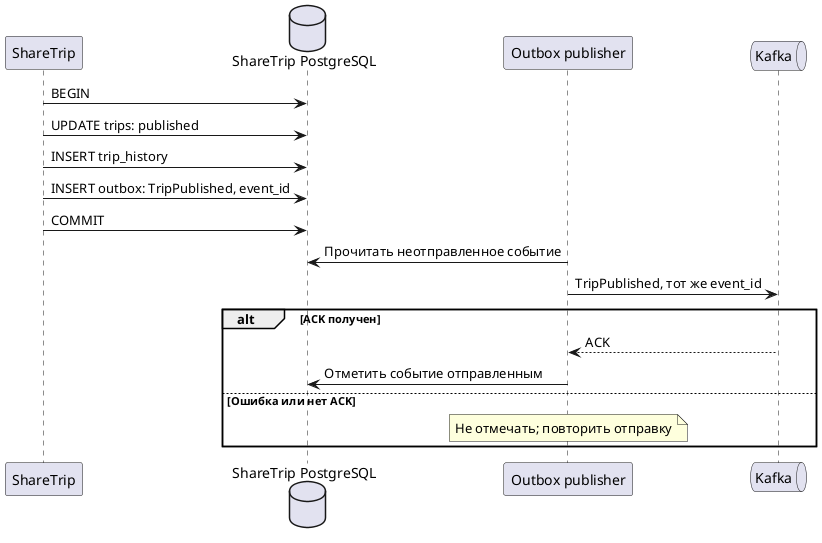
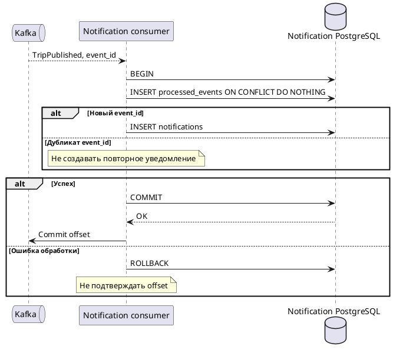
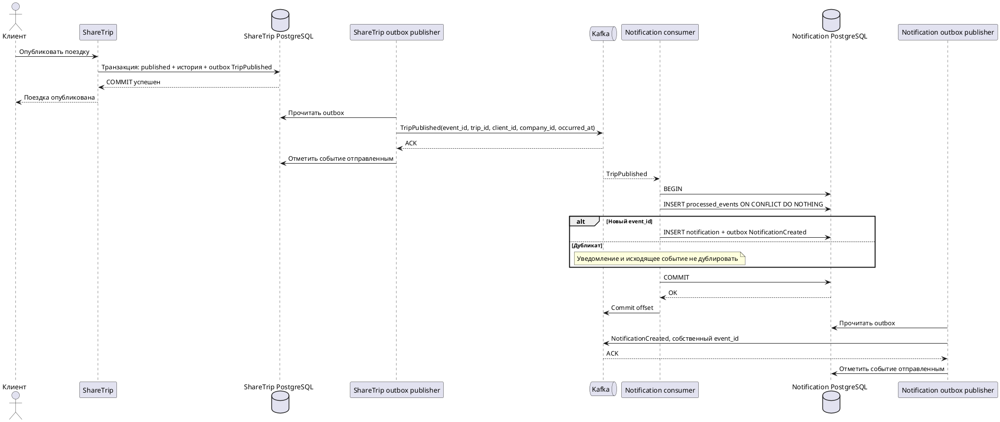

## 1. Проблема двойной записи

Публикация поездки меняет PostgreSQL и отправляет `TripPublished` в Kafka. Эти действия не входят в одну локальную транзакцию: успешный COMMIT БД не гарантирует отправку события.

## 2. Как можно потерять событие

После COMMIT поездки сервис может упасть до отправки в Kafka. Без outbox поездка останется опубликованной, а уведомление не появится.

В текущем ShareTrip событие сохраняется в outbox вместе с поездкой, поэтому запись события не теряется. Но автоматического отправителя outbox пока нет: при сбое Kafka доставка остановится. Повтор публикации уже опубликованной поездки не отправляет событие заново.

## 3. Почему retry недостаточен для пишущих операций

Таймаут не означает, что операция не выполнена: Kafka могла принять событие, а подтверждение потерялось. Повтор создаст ещё одно сообщение. Без защиты consumer создаст второе уведомление. Нужны сохранённое событие в outbox, неизменный `event_id` при повторах и inbox на стороне получателя. Retry также не отменяет уже выполненные шаги бизнес-процесса.

## 4. Читающая и пишущая нагрузка

- Чтение: получение поездки и проверка `trip_publication` в Contract Service. Проверка использует POST, но не изменяет состояние; повтор не создаёт бизнес-эффекта.
- Запись: публикация поездки, отправка `TripPublished`, создание уведомления. Для повторов нужны идемпотентность и защита от дублей.

## 5. Где нужен outbox

В ShareTrip: изменение статуса поездки, история и `TripPublished` сохраняются одной транзакцией PostgreSQL. Отдельный отправитель читает неотправленные события, отправляет их в Kafka и отмечает отправленными только после ACK брокера. При ошибке повторяет отправку с тем же `event_id`. Сбой между ACK и отметкой может вызвать дубль.

## 6. Где нужен inbox

В Notification Service: запись `event_id` в `processed_events` и создание уведомления выполняются одной транзакцией. Уже обработанное событие не создаёт уведомление повторно. Offset Kafka подтверждается после COMMIT. При откате offset не подтверждается; повторная доставка после перезапуска безопасна. Этот механизм уже реализован.

## 7. Возможные компенсации в ShareTrip

- Отмена публикации поездки, если обязательный последующий бизнес-шаг окончательно отклонён. Отмена оформляется допустимым переходом состояния с историей и событием.
- Освобождение резерва или возврат денег, если в процесс будет добавлена оплата, а поездка отменена.
- Новое уведомление об отмене или исправлении, если первоначальное уже отправлено клиенту.

Временный сбой доставки уведомления требует повторной обработки, а не отмены публикации. Конкретные компенсации определяются бизнес-правилами; сейчас saga не реализована.

## 8. PlantUML: outbox

## 9. PlantUML: inbox

## 10. PlantUML: TripPublished → NotificationCreated

Целевая схема: `NotificationCreated` пока не публикуется. Для его надёжной отправки Notification Service потребуется собственный outbox.

