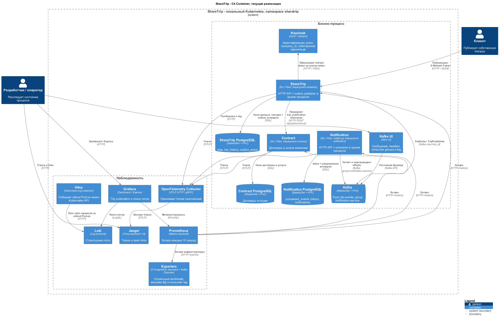
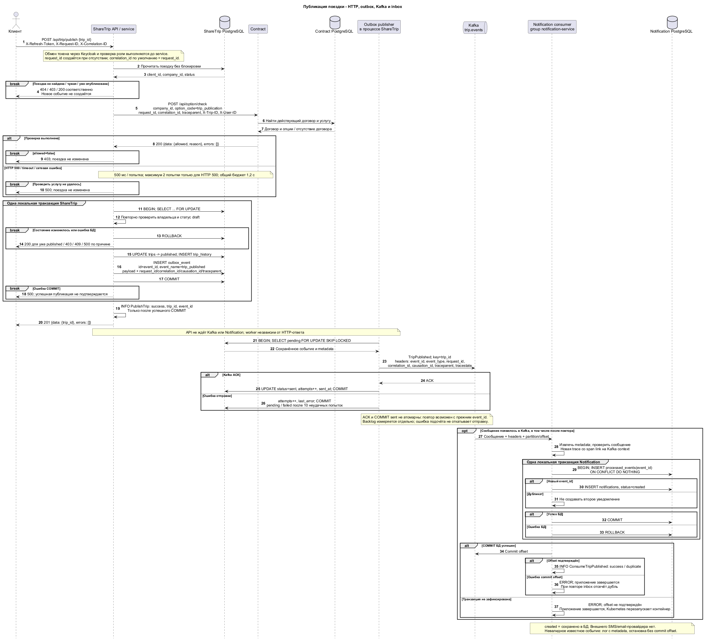

# Архитектурное ревью процесса публикации поездки

Срез реализации: 27 октября 2026 года. Документ описывает фактический код трёх
сервисов. Граница текущего процесса - сохранённое уведомление в PostgreSQL;
доставки через SMS/email-провайдера пока нет.

## 1. Process overview

1. Клиент отправляет `POST /api/trip/publish` с `trip_id` и `X-Refresh-Token`.
   ShareTrip обменивает refresh token в Keycloak на access token, читает claims
   полученного токена и проверяет роль клиента.
2. ShareTrip читает поездку без блокировки, проверяет владельца и берёт `company_id`
   из сохранённой поездки. Уже опубликованная поездка возвращает HTTP 200 без нового события.
3. Синхронный `POST /api/option/check` в Contract проверяет услугу `trip_publication`
   для компании. Contract не проверяет владельца поездки и не заменяет авторизацию.
4. ShareTrip открывает транзакцию, читает поездку с `SELECT FOR UPDATE` и повторно
   проверяет владельца и переход `draft -> published`.
5. В одной транзакции сохраняются поездка, история и `outbox_event`. После COMMIT
   API возвращает HTTP 201 и пишет итоговый лог с `trip_id` и `event_id`.
6. Outbox publisher в процессе ShareTrip выбирает pending-события и отправляет их в Kafka.
   HTTP-команда не ждёт Kafka или Notification.
7. Consumer в процессе Notification читает `trip.events`. В одной транзакции вставляет
   `event_id` в `processed_events` и создаёт запись `notifications`.
8. После COMMIT consumer подтверждает offset Kafka. Дубль `event_id` не создаёт
   второе уведомление, но его offset также подтверждается.



[Исходник C4 Container](diagrams/microservices-containers.puml).
Publisher и consumer находятся внутри соответствующих приложений, без отдельных Deployment.



[Исходник sequence](diagrams/microservices-publication.puml).
Расположение этапов после HTTP-ответа служит для чтения: publisher работает независимо
и может отправить событие ещё до получения ответа клиентом.

Опорный код: [сервис публикации](../internal/service/publish_trip.go),
[изменение поездки](../internal/domain/publish_trip_domain.go),
[publisher](../internal/service/outbox_publisher.go).
В `share-trip-notification`: `internal/events/consumer.go`,
`internal/service/handle_trip_published.go`, `internal/domain/handle_trip_published.go`.

## 2. Services

| Сервис | Ответственность и собственные данные | Вне границы |
| --- | --- | --- |
| ShareTrip | Агрегат поездки, владелец и компания поездки, статус, история, outbox | Договоры компании, inbox и уведомления |
| Contract | Договор компании с платформой, сроки, статус, доступность услуг | Роли пользователя, владение поездкой, статусы поездок |
| Notification | Inbox `processed_events`, получатель и запись уведомления | Договоры и изменение состояния поездки |

У каждого сервиса отдельный PostgreSQL и свои миграции. Общей прикладной БД,
межсервисных SQL JOIN и чтения ShareTrip из таблиц Contract нет. `company_id`
и `client_id` - внешние идентификаторы, а не межбазовые foreign key.
ShareTrip получает готовое решение по HTTP и не копирует правила договоров.

Keycloak отвечает за аутентификацию и claims. ShareTrip проверяет роль и владельца
поездки; Contract отвечает, разрешена ли услуга компании. Это намеренное отличие
от примера урока о проверке пользователя в Contract.

## 3. Contracts

### HTTP: ShareTrip -> Contract

`POST http://contract-service:8080/api/option/check`:

```json
{"company_id":"company-acme","option_code":"trip_publication"}
```

HTTP 200 с разрешением:

```json
{"data":{"allowed":true},"errors":[]}
```

Штатный отказ также возвращает HTTP 200:

```json
{"data":{"allowed":false,"reason":"CONTRACT_EXPIRED"},"errors":[]}
```

Причины: `CONTRACT_NOT_FOUND`, `NO_ACTIVE_CONTRACT`, `CONTRACT_NOT_STARTED`,
`CONTRACT_EXPIRED`, `SERVICE_NOT_ALLOWED`. Ошибки транспортной валидации дают
HTTP 400, внутренние ошибки Contract - HTTP 500 с оболочкой `data/errors`.
Источник - `api/contract.yaml` репозитория `share-trip-contract`;
[сгенерированный клиент](../internal/clients/contract/gen/client.gen.go) находится в ShareTrip.

Передаются `X-Request-ID`, `X-Correlation-ID`, `traceparent`, `tracestate`, а также
диагностические `X-Trip-ID` и `X-User-ID`. Последний соответствует `client_id`
и не используется Contract для авторизации.

Политика клиента: 500 мс на попытку, 1,2 с на проверку, максимум две попытки с паузой
100 мс. Повторяется только HTTP 500; timeout, сетевые ошибки, HTTP 400/503 и некорректный
JSON не повторяются. Родительский deadline может завершить проверку раньше.
Timeout команды ShareTrip - 2 с. Keycloak вызывается в отдельном middleware со своим
timeout, поэтому 2 с нельзя считать гарантированным пределом всего внешнего запроса.
Отказ Contract приводит к HTTP 403 ShareTrip, техническая ошибка проверки - к HTTP 500;
поездка и outbox не меняются.

Открытый дефект: HTTP 200 без обязательного `data.allowed` может декодироваться как
`allowed=false` и превратить нарушение контракта в бизнес-отказ. Подробности и пробелы
в тестах клиента зафиксированы в [предыдущем ревью](contract-client-review.md).

### Kafka: ShareTrip -> Notification

Topic - `trip.events`, consumer group - `notification-service`, ключ сообщения - `trip_id`.

```json
{
  "event_id": "78910abc-1234-4567-89ab-1234567890ab",
  "event_type": "TripPublished",
  "trip_id": "f9b711e3-8f45-4dc3-8cab-07623f5de6e5",
  "client_id": "a1b2c3d4-1111-4111-8111-123456789abc",
  "company_id": "company-acme",
  "occurred_at": "2026-10-27T09:00:00Z",
  "request_id": "request-123",
  "correlation_id": "publication-456",
  "causation_id": "request-123",
  "traceparent": "00-4bf92f3577b34da6a3ce929d0e0e4736-00f067aa0ba902b7-01"
}
```

`event_id` берётся из outbox `id`, `occurred_at` - из времени публикации, сохранённого
в `outbox_event.created_at`. В БД имя события - `trip_published`, в Kafka - `TripPublished`.
Metadata хранится в JSON outbox вместе с бизнес-полями; ID и время - отдельными колонками.
Kafka headers: `event_id`, `event_type`, `request_id`, `correlation_id`, `causation_id`,
`traceparent`, `tracestate`. Последний опционален. Header `traceparent` указывает на
текущий producer span, а поле JSON сохраняет исходный контекст события.

Consumer проверяет совпадение `event_id/event_type` headers с телом; остальные metadata
из headers имеют приоритет. Старые сообщения без headers читаются из payload.
При повреждённом JSON известные headers остаются в логе. Неизвестный тип пропускается
с commit offset; повреждённое известное событие останавливает consumer без commit.
Версии схемы и DLQ пока нет. Подробности: [контракт события](kafka-producer.md).

## 4. Consistency

**ShareTrip:** `UPDATE trips + INSERT trip_history + INSERT outbox_event` выполняются
в одной локальной транзакции. Ошибка COMMIT не подтверждается как успешная публикация.
Contract вызывается до транзакции, чтобы не держать блокировку во время сетевого ожидания.
Общей транзакции с Contract нет: договор может измениться между проверкой и COMMIT поездки.

Publisher выбирает строки через `FOR UPDATE SKIP LOCKED` и удерживает блокировки
до COMMIT batch, включая ожидание Kafka. Producer использует `RequiredAcks=all`.
После ACK записываются `sent`, `attempts`, `sent_at`; при ошибке - `attempts` и `last_error`.
После 10 неудачных зафиксированных попыток статус становится `failed`.
Опрос - каждую 1 с, batch до 10 событий, timeout batch 15 с. Вызов producer ограничен
1 с и допускает до трёх внутренних Kafka-попыток в этом бюджете.

Kafka ACK и COMMIT `sent` не атомарны: падение между ними даёт повтор с прежним
`event_id`. Это at-least-once, не exactly-once. Backlog измеряется отдельной транзакцией
после batch; ошибка подсчёта не откатывает доставку.

**Notification:** `INSERT processed_events + INSERT notifications` объединены
транзакцией. Primary key `processed_events.event_id` защищает и от конкурентных дублей.
COMMIT offset выполняется после COMMIT БД в общем 10-секундном бюджете обработки.
Сбой offset после COMMIT БД приводит к безопасному повтору через inbox. Ошибка БД
откатывает обе записи и оставляет offset неподтверждённым.

| Операция | Повтор |
| --- | --- |
| Проверка услуги | Безопасное чтение; клиент повторяет только HTTP 500 |
| Уже опубликованная поездка | HTTP 200 без новой истории и события |
| Отправка outbox | С прежним event_id; Kafka может получить несколько копий |
| Обработка события | Inbox предотвращает повторное создание уведомления |
| Outbox в failed | Автоповтора нет; нужно устранить причину и принять решение о повторе с прежним event_id |

Saga и компенсация публикации здесь не нужны: сбой уведомления не должен отменять
опубликованную поездку. Внешний провайдер потребует отдельной модели доставки,
повторов и идемпотентности: текущая транзакция inbox не атомарна с будущим SMS/email.

## 5. Runtime

Namespace - `sharetrip`. Запуск - `make k8s-up`; [адреса стенда](addresses.md).

| Deployment | Процессы | HTTP Service | ConfigMap / Secret |
| --- | --- | --- | --- |
| sharetrip | API + outbox publisher | `sharetrip-service:8080` | `sharetrip-config` / `sharetrip-secret` |
| contract | API | `contract-service:8080` | `contract-config` / `contract-secret` |
| notification | API + consumer | `notification-service:8080` | `notification-config` / `notification-secret` |

Worker-ам отдельный Service не нужен: они сами подключаются к Kafka. Notification
имеет Service ради API и `/metrics`, а не для получения Kafka-сообщений.
У приложений по одной реплике и стандартный rolling update. Ошибка consumer завершает
приложение Notification вместе с HTTP API; Kubernetes перезапускает контейнер.

ConfigMap содержит адреса, timeout, лимиты и уровень логов; Secret - DSN и секреты
доступа. Они передаются через `envFrom`; изменение env требует перезапуска Pod.
Реальные Secret-файлы и `.env` исключены из Git. Secret сам по себе не гарантирует
шифрование хранения: RBAC, шифрование и защита резервных копий требуют отдельной настройки.

PostgreSQL сервисов и Kafka работают в StatefulSet с PVC. Один брокер и один экземпляр
каждого PostgreSQL не обеспечивают высокую доступность. Миграции остаются в репозиториях,
но migration Job в текущем запуске нет; наличие нужных таблиц - предварительное условие.

**Ограничение probes:** только TCP readiness на HTTP-порту, без liveness и startup probe.
Открытый порт не подтверждает работу БД, Kafka или продвижение consumer. Зависший процесс
может оставаться Ready. Перезапуск завершившегося процесса работает без liveness,
но обнаружение зависания требует отдельного решения.
Манифесты: [ShareTrip](../k8s/sharetrip-deployment.yaml),
[Contract](../k8s/contract-deployment.yaml), [Notification](../k8s/notification-deployment.yaml).

## 6. Observability

| Идентификатор | Назначение |
| --- | --- |
| request_id | HTTP-команда и вызов Contract; создаётся при отсутствии X-Request-ID |
| correlation_id | Весь процесс; по умолчанию исходный request_id |
| causation_id | Для TripPublished - request_id породившей команды |
| event_id | Outbox, копии Kafka, inbox и обработчик; сохраняется при повторе |
| trace_id | Синхронная trace; consumer создаёт другую trace со span link на Kafka context |

Через HTTP и Kafka передаётся W3C `traceparent`. `client_id` соответствует `user_id`
из урока. Идентификаторы остаются в логах и span attributes, не в labels Prometheus.
Логи используют `service`, `component`, `operation`, `result`. Проверка Contract на INFO
имеет `operation=CheckPermission`; успешный PublishTrip содержит committed `event_id`.
Промежуточные OutboxInsert/InboxInsert доступны на DEBUG; на INFO используются итоги и БД.

| Метрики | Что измеряют |
| --- | --- |
| `sharetrip_trip_publish_total{result}`, `sharetrip_trip_publish_duration_seconds{result}` | Команды публикации и длительность сервисной операции |
| `sharetrip_contract_request_total{result}`, `sharetrip_contract_request_duration_seconds{result}` | Проверку Contract с повторами: allowed/denied/error |
| `contract_permission_check_total{result}`, `contract_permission_check_duration_seconds{result}` | Проверки Contract; каждая HTTP-попытка отдельно |
| `sharetrip_http_requests_total{method,route,status}`, `sharetrip_http_request_duration_seconds{method,route,status}` | HTTP ShareTrip |
| `contract_http_requests_total{method,route,status}`, `contract_http_request_duration_seconds{method,route,status}` | HTTP Contract |
| `sharetrip_outbox_pending` | Gauge последнего успешного подсчёта pending |
| `sharetrip_outbox_publish_total{result}`, `sharetrip_outbox_publish_failed_total` | Отправку Kafka; success означает ACK, не COMMIT sent |
| `notification_consume_total{result}`, `notification_consume_duration_seconds{result}` | Обработку с commit offset: success/duplicate/ignored/error |
| `notification_inbox_duplicate_total` | Дубликаты после успешной inbox-транзакции |
| `notification_persist_total{result}`, `notification_persist_duration_seconds{result}` | Сохранение уведомления: created/error; не внешнюю доставку |
| `kafka_consumergroup_lag`, `kafka_consumergroup_members`, `kafka_topic_partitions` | Lag, участников группы и partitions через Kafka Exporter |

`sharetrip_outbox_pending` и `notification_persist_*` уточняют смысл учебных названий
`sharetrip_outbox_pending_total` и `notification_send_*`. Label `route` содержит шаблон маршрута.

[Dashboard Trip publication](http://localhost:33000/d/trip-publication) содержит 15 панелей:
публикации, отказы, p95 HTTP/Contract, outbox backlog/errors, lag, inbox-дубли,
результаты consumer, ошибки сохранения уведомлений и scrape health.
[Исходник dashboard](../k8s/config/trip-publication.json).
Панель ошибок публикации включает бизнес-отказы, а не только технические сбои.
Для partition без первого commit exporter отдаёт lag -1; dashboard считает остаток
как latest minus oldest с учётом `FirstOffset` consumer.

Alloy передаёт stdout Pod-ов в Loki; Prometheus опрашивает приложения и exporters
каждые 10 с; traces идут через OTel Collector в Jaeger. Grafana показывает dashboard
и поиск логов. Отсутствие ряда не означает отсутствие ошибок.

**Ограничения:** правил алертинга и Alertmanager нет. Gauge при ошибке подсчёта
сохраняет старое значение и не включает failed. Нулевой pending возможен при недоставленных
failed-событиях. Нужны проверка failed и свежести данных; dashboard не заменяет алертинг.

## 7. Failure scenarios

| Сценарий | Поведение | Диагностика и восстановление |
| --- | --- | --- |
| Contract недоступен | Timeout/ошибка; повтор только HTTP 500, не больше двух попыток. ShareTrip: HTTP 500, без публикации | Лог клиента CheckOption, request_id/correlation_id, result=error и метрика вызова. Восстановить Contract и повторить команду |
| Contract запрещает услугу | ShareTrip: HTTP 403; поездка и outbox не меняются | CheckPermission result=denied; проверить договор и услугу компании |
| Kafka недоступна | Поездка может быть опубликована, событие остаётся pending, затем failed после лимита | Outbox errors, last_error и статусы БД. После восстановления pending повторяется; failed требует отдельного решения |
| Kafka ACK получен, COMMIT sent не состоялся | Повторная отправка того же event_id | Сопоставить ACK и outbox; inbox защищает локальный результат от дубля |
| Notification упал | Kafka хранит события в пределах retention, offsets не продвигаются | Lag, участники группы, Pod и предыдущие логи. После рестарта чтение с committed offsets; до первого commit - FirstOffset |
| Ошибка БД Notification | Inbox и уведомление откатываются, offset не подтверждается; приложение завершается | ConsumeTripPublished result=error, trace и отсутствие committed inbox. Устранить причину, дождаться рестарта |
| Дубликат / падение после COMMIT БД | Inbox не создаёт второе уведомление; offset подтверждается при повторе | result=duplicate, счётчик inbox duplicate, одна запись уведомления |
| Повреждённое известное событие | Нет commit offset; возможен цикл рестартов consumer | WARN с metadata из headers, topic/partition/offset. Разобрать сообщение; DLQ и автоматического пропуска нет |
| Потеря correlation_id | Для legacy используется event_id, связь с исходным HTTP может потеряться | Сверить outbox, Kafka headers, request_id и trace link. Для новых событий потеря propagation - дефект |
| Уведомление не найдено | Сбой возможен на любом асинхронном этапе; поездка не откатывается | Пройти инструкцию ниже; notifications означает только сохранение, не внешнюю доставку |

Доказательства в существующих тестах:

- [HTTP-клиент](../internal/clients/contract/client_test.go): HTTP 500 retry, timeout без retry, отмена.
- [Сервис публикации](../internal/service/publish_trip_test.go): запрет, повтор, ошибки outbox и COMMIT.
- [Outbox + PostgreSQL](../internal/api_test/outbox_publisher_test.go): восстановление, лимит попыток, ACK до ошибки БД, конкурентные workers, совместный rollback и независимость Gauge.
- [Outbox + Kafka + PostgreSQL](../internal/api_test/outbox_kafka_test.go): реальная отправка и восстановление после недоступного брокера.
- В `share-trip-notification`: `internal/api_test/trip_published_test.go` - дубли, конкуренция, rollback; `internal/api_test/kafka_consumer_test.go` - Kafka/БД/offsets; `internal/events/observability_test.go` - metadata, span link и ошибки offset.

Это перечень проверок в исходниках, а не отчёт о новых авариях на стенде. Kafka-тесты
требуют `KAFKA_TEST_BROKERS`, иначе пропускаются. Полный сценарий HTTP -> Kafka -> consumer
заново при подготовке документа не выполнялся. Пробелы клиента: [предыдущее ревью](contract-client-review.md).

## 8. Trade-offs

| Выигрыш | Цена |
| --- | --- |
| Единые правила договоров в Contract | Сетевая зависимость перед публикацией, timeout, технические отказы |
| Notification не блокирует публикацию | Eventual consistency: HTTP 201 не обещает готовое уведомление |
| Outbox сохраняет событие вместе с поездкой | Таблица, worker, блокировки на время Kafka-вызова, дубли и ручной разбор failed |
| Inbox защищает локальный результат | Рост таблицы event_id; нет exactly-once для внешнего провайдера |
| Собственные БД и контракты | Распределённые миграции, версии API/событий и диагностика; нет общей транзакции |
| Kubernetes даёт discovery, рестарты и rolling update | Нужны probes, секреты и эксплуатация; локальная схема не отказоустойчива |
| Metadata связывает процесс | Нужна дисциплина propagation, поддержка dashboard и понимание метрик |

Разделение оправдано независимыми правилами договоров и асинхронными уведомлениями.
Оно позволяет развивать сервисы отдельно, но publisher/consumer пока масштабируются
вместе с HTTP API. Для небольшого приложения без независимых команд и нагрузки модульный
монолит с worker был бы дешевле. Количество сервисов само по себе не цель.

### Если завтра уведомления перестанут приходить: как найти причину за 10 минут?

**0-2 минуты: найти процесс.** Получить trip_id, время и request_id, если он известен.
В Grafana Explore выбрать Loki, найти PublishTrip и скопировать correlation_id и event_id.
Открыть [dashboard](http://localhost:33000/d/trip-publication): backlog, outbox errors,
lag `notification-service`, результаты consumer и scrape health.

```logql
{namespace="sharetrip"} | json | trip_id="<trip_uuid>"
{namespace="sharetrip"} | json | correlation_id="<correlation_id>"
{namespace="sharetrip", app="notification"} | json | event_id="<event_uuid>"
```

**2-4 минуты: проверить команду и outbox.** Найти CheckPermission по correlation_id.
В БД ShareTrip выполнить:

```sql
SELECT id, status, company_id FROM trips WHERE id = '<trip_uuid>';
SELECT id AS event_id, status, attempts, last_error, sent_at,
       payload->>'correlation_id' AS correlation_id
FROM outbox_event WHERE aggregate_id = '<trip_uuid>';
```

Без опубликованной поездки искать отказ команды. Отсутствие outbox после подтверждённой
новой публикации требует разбора транзакции. У pending/failed читать last_error.
Sent означает фиксацию ACK Kafka, а не готовое уведомление.

**4-7 минут: проверить Kafka и consumer.** В [Kafka UI](http://localhost:38085) открыть
`trip.events`, найти event_id и headers; проверить lag и участников `notification-service`.
Нулевой lag не доказывает, что нужное событие вообще попало в topic.

```cmd
kubectl --context docker-desktop get pods -n sharetrip
kubectl --context docker-desktop logs -n sharetrip deployment/notification --since=30m
```

Для предыдущего упавшего контейнера взять имя Pod из первой команды:
`kubectl --context docker-desktop logs -n sharetrip <notification-pod> --previous`.
Не сбрасывать offsets до разбора причины.

**7-10 минут: проверить результат и trace.** В БД Notification выполнить:

```sql
SELECT event_id, processed_at FROM processed_events WHERE event_id = '<event_uuid>';
SELECT id, status, recipient_id, created_at
FROM notifications WHERE payload->>'trip_id' = '<trip_uuid>';
```

Inbox без результата требует проверки обработчика, получателя и истории изменений БД.
При отсутствии обоих результатов проверить rollback и offset. Открыть trace_id из логов
в [Jaeger](http://localhost:36686): HTTP и consumer имеют разные trace_id, связанные
span link, correlation_id и event_id. Наличие уведомления в БД означает завершение
текущего процесса; SMS/email-провайдера, ошибки которого можно было бы искать, пока нет.
Дополнительные запросы: [инструкция расследования](observability.md#как-расследовать-уведомление-не-пришло).
