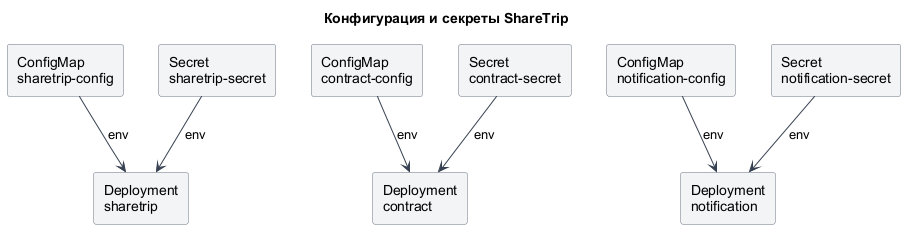

# Локальный стенд в Kubernetes

Из репозитория share-trip:

```cmd
make k8s-up
```

Нужны Docker Desktop с включённым Kubernetes, контекст `docker-desktop`, Go, Docker CLI и kubectl.
Команда рассчитана на локальный узел `desktop-control-plane` и Docker context `desktop-linux`.
Другие кластеры она не изменяет.

Репозитории contract и notification по умолчанию ищутся в `%USERPROFILE%\GolandProjects\share-trip-contract`
и `%USERPROFILE%\GolandProjects\share-trip-notification`. Другие пути можно задать перед запуском:

```cmd
set CONTRACT_PROJECT_DIR=C:\projects\share-trip-contract
set NOTIFICATION_PROJECT_DIR=C:\projects\share-trip-notification
make k8s-up
```

В каждом репозитории нужен заполненный `.env`: PostgreSQL URL в DATABASE_DSN либо
POSTGRES_USER, POSTGRES_PASSWORD и POSTGRES_DB. В share-trip также нужны
KEYCLOAK_CLIENT_SECRET и POSTGRES_EXPORTER_PASSWORD. Секреты передаются Kubernetes через stdin,
не попадают в манифесты Git и не выводятся командой запуска.

## Что запускается

Три приложения, три PostgreSQL, Kafka, Kafka UI, Keycloak, Prometheus,
три PostgreSQL Exporter, Kafka Exporter, Grafana, Loki, Alloy, Jaeger и OTel Collector работают в namespace `sharetrip`.
Внутри кластера используются Service DNS; зависимостей от `host.docker.internal` нет.

`cmd/devstack` собирает и импортирует образы приложений в containerd Docker Desktop,
поднимает хранилища и запускает приложения. Job `exporter-init-*` настраивают пользователя
мониторинга PostgreSQL, ожидая доступности БД через Service; Job `kafka-init` создаёт топик
`trip.events`. Эти операции можно повторять; они не применяют SQL-миграции приложений.
SQL-миграции не входят в `k8s-up`: существующая схема БД сохраняется в PVC.
Для пустой БД или изменения схемы применяйте исходные миграции соответствующего сервиса отдельно.

`make migrate-up/down/status` используют подключение из локального `.env`, а не Secret Kubernetes.
Для работы с БД стенда сначала откройте отдельный port-forward к нужной БД и проверьте DSN.
Например, для ShareTrip: `kubectl --context docker-desktop port-forward -n sharetrip svc/postgres-sharetrip 6543:5432`.
Для Contract и Notification используйте соответственно `postgres-contract` с локальным портом 6545
и `postgres-notification` с портом 6544; команды миграций запускаются в репозитории соответствующего сервиса.

Генерация клиента из OpenAPI работающего стенда:
`make generate-contract-client` (по умолчанию `http://localhost:38082/api/contract.yaml`).
Для Contract, запущенного из IDE, переопределите источник:
`make generate-contract-client CONTRACT_OPENAPI_URL=http://localhost:4002/api/contract.yaml`.

При повторном `make k8s-up` данные не восстанавливаются заново: используются текущие PVC.
Образы приложений пересобираются; их pod-ы заменяются. При ошибке запуск завершается с ненулевым кодом.

## Первый перенос с Compose

Первый запуск останавливает приложения Kubernetes и контейнеры текущего Compose,
сохраняет холодные архивы всех PostgreSQL, Kafka, Keycloak, Grafana, Loki и Prometheus
в `.local/k8s/backup`, затем восстанавливает их в PVC. Сохраняются пользователи и роли БД,
realm и пользователи Keycloak, топики Kafka, consumer offsets и данные мониторинга.
Исходные контейнеры и Docker volumes остаются на месте.

Переносятся контейнеры `pg`, `pg-contract`, `pg-notification`, `sharetrip-kafka`,
`sharetrip-keycloak`, `grafana`, `loki`, `prometheus`. Должны присутствовать все восемь
или ни одного: неполный исходный набор требует ручной проверки.
До переноса остановите приложения, запущенные напрямую из IDE, чтобы они не писали в старые БД.

`.local` исключён из Git и Docker build context. Архивы содержат секреты и пользовательские данные;
не публикуйте их. Состояние переноса привязано к UID namespace: после удаления namespace
команда потребует проверки архивов, а не начнёт незаметно с пустых БД.

Если перенос прервался, исправьте указанную причину и повторите `make k8s-up`.
Завершённые резервные копии повторно не снимаются; после отметки storage-ready старые данные
больше не копируются поверх PVC. Не удаляйте `.local/k8s`, пока используете этот стенд.

Для возврата на Compose остановите приложения Kubernetes и запустите исходные Compose-проекты.
Это вернёт состояние **на момент переноса**: новые записи Kubernetes в Docker volumes не копируются.
Предыдущие ConfigMap и Secret сохранены в `.local/k8s/backup` для ручного восстановления конфигурации.

## Адреса

Полная карта внешних и внутренних адресов, маршруты API и примеры Postman:
[docs/addresses.md](../docs/addresses.md).

Старые port-forward на 18080/18081/18082 можно закрыть. Они больше не нужны.

После переноса получите **новые токены** первым запросом в `deploy/keycloak/auth.http`.
Пользователи, client secret и company_id сохраняются, но внешний issuer теперь
`http://localhost:38087/realms/sharetrip`. В приложении KEYCLOAK_ISSUER указывает на
внутренний `http://keycloak:8080/realms/sharetrip`; backchannel dynamic включён.
В Postman используйте новый refresh token в заголовке `X-Refresh-Token`.

Keycloak работает в локальном start-dev с H2 и одним экземпляром. Если исходных контейнеров нет,
БД создаются пустыми. Realm sharetrip, клиент sharetrip-api, роль client и mapper company_id
импортируются из k8s/config/sharetrip-realm.json; secret берётся из окружения. Существующий realm
импорт не перезаписывает. Для нового стенда создайте пользователя, назначьте роль client
клиента sharetrip-api и атрибут company_id, затем создайте и активируйте договор компании.

## Остановка и диагностика

```cmd
make k8s-down
make k8s-up
kubectl --context docker-desktop get pods,pvc,svc -n sharetrip
kubectl --context docker-desktop logs -n sharetrip deployment/sharetrip --tail=100
```

`k8s-down` уменьшает число экземпляров приложений и инфраструктуры до нуля.
Namespace, Secret, ConfigMap и PVC сохраняются. Удаление namespace удалит PVC — это не команда остановки.
Применять весь каталог k8s рекурсивно нельзя: он содержит примеры Secret и отдельные фазы запуска.

Prometheus читает `/metrics` всех трёх приложений без токена и метрики Kafka/PostgreSQL Exporter;
бизнес-маршруты `/api/trip` требуют авторизации.
Alloy читает stdout pod-ов только namespace sharetrip через Kubernetes API и отправляет их в Loki.
Grafana получает источники Prometheus, Loki и Jaeger через provisioning.
Трейсы Jaeger, как и раньше в Compose, хранятся в памяти и пропадают при перезапуске.
Dashboard Trip publication и расследование задержек уведомления: [docs/observability.md](../docs/observability.md).

## Изменение конфигурации

Работающий процесс не перечитывает переменные окружения. После изменения ConfigMap примените файл
и выполните rollout restart соответствующего Deployment. Изменения `.env` подхватывает `make k8s-up`.
Для инфраструктуры изменение ConfigMap/Secret также требует перезапуска соответствующего workload.

Это локальный учебный стенд: по одному экземпляру, без TLS и внешней аутентификации Kafka.
Данные хранятся на диске Docker Desktop; резервные копии находятся отдельно в `.local/k8s/backup`.

## Обязательные переменные

| Сервис | ConfigMap | Secret |
| --- | --- | --- |
| sharetrip | CONTRACT_SERVICE_URL, KAFKA_BROKERS, KEYCLOAK_ISSUER | DATABASE_DSN, KEYCLOAK_CLIENT_SECRET |
| contract | Нет обязательных переменных без defaults | DATABASE_DSN |
| notification | KAFKA_BROKERS | DATABASE_DSN |

DATABASE_DSN имеет приоритет. Для совместимости с локальным Compose без DATABASE_DSN
нужны POSTGRES_USER, POSTGRES_PASSWORD и POSTGRES_DB; DB_HOST по умолчанию localhost,
POSTGRES_PORT — 6543/6545/6544 соответственно, DB_SSLMODE — disable.
В Kubernetes используется только DATABASE_DSN. Для внешней БД настройте TLS под её сертификаты.

## Обычные настройки

| Переменная | Сервисы | Default |
| --- | --- | --- |
| HTTP_PORT | Все | Локально 8080/4002/4001; в ConfigMap всех сервисов 8080 |
| REQUEST_TIMEOUT_MS | Все | 2000 |
| LOG_LEVEL | Все | INFO |
| LOG_FILE | Все | Пусто: stdout; локально можно задать путь |
| KAFKA_TRIP_TOPIC | sharetrip, notification | trip.events |
| KAFKA_GROUP_ID | notification | notification-service |
| HANDLE_TIMEOUT_MS | notification | 10000 |
| CONTRACT_REQUEST_TIMEOUT_MS | sharetrip | 500 на попытку |
| CONTRACT_CHECK_TIMEOUT_MS | sharetrip | 1200 на всю проверку |
| RETRY_ATTEMPTS | sharetrip | 2, включая первый запрос |
| RETRY_DELAY_MS | sharetrip | 100 |
| KAFKA_PUBLISH_TIMEOUT_MS | sharetrip | 1000 |
| KAFKA_PUBLISH_ATTEMPTS | sharetrip | 3 внутри kafka-go |
| OUTBOX_POLL_INTERVAL_MS | sharetrip | 1000 |
| OUTBOX_BATCH_TIMEOUT_MS | sharetrip | 15000 |
| OUTBOX_BATCH_SIZE | sharetrip | 10 |
| OUTBOX_MAX_ATTEMPTS | sharetrip | 10 |
| KEYCLOAK_CLIENT_ID | sharetrip | sharetrip-api |
| KEYCLOAK_TIMEOUT_MS | sharetrip | 5000 |
| APP_ENV | Все | local |
| OTEL_EXPORTER_OTLP_ENDPOINT | Все | localhost:14319, в ConfigMap otel-collector:4318 |

Имена переменных одинаковы для local/dev/stage/prod. Адреса меняются в конфигурации,
образы приложений остаются теми же. KAFKA_TRIP_TOPIC сохраняет существующее имя переменной проекта.

Числа должны быть положительными; HTTP-порт — 1–65535, число HTTP-попыток и внутренних Kafka-попыток — не более 10,
размер пачки — не более 100. Бюджет проверки договора должен покрывать все попытки
и задержки; HTTP-таймаут должен оставлять время для БД. Таймаут пачки должен покрывать
отправку всех её событий. Retry договора по-прежнему применяется только к HTTP 500.
Порог failed в outbox задаётся OUTBOX_MAX_ATTEMPTS; по умолчанию это 10 неудачных попыток worker.

## Диаграмма конфигурации и секретов

Каждый Deployment получает переменные окружения только из собственного ConfigMap и Secret.



[Исходник PlantUML](../docs/diagrams/configuration-and-secrets.puml).

